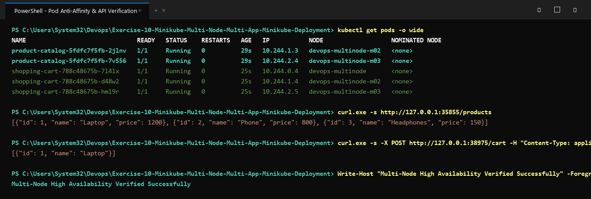

# Exercise 10: Multi-Node Kubernetes Cluster with Multiple Applications and ReplicaSets

## Objective
Deploy a resilient, highly available multi-tier e-commerce architecture across a 3-node Kubernetes cluster using Minikube, leveraging `podAntiAffinity` to guarantee that application replicas are spread across separate physical/virtual nodes.

## Storyboard & Architecture
An e-commerce platform requires high availability for two critical services:
1. **Product Catalog (`product-catalog`)**: Microservice serving catalog and product listings (2 replicas).
2. **Shopping Cart (`shopping-cart`)**: Microservice managing customer active shopping carts (3 replicas).

### High Availability via `podAntiAffinity`
To prevent a single point of failure (node outage) from bringing down either service, `podAntiAffinity` rules with `topologyKey: "kubernetes.io/hostname"` ensure:
- Replicas of `product-catalog` never co-locate on the same node.
- Replicas of `shopping-cart` are distributed across `devops-multinode`, `devops-multinode-m02`, and `devops-multinode-m03`.

## Files in this Exercise
- `product_catalog.py`: Flask service exposing `GET /products`.
- `shopping_cart.py`: Flask service exposing `GET /cart` and `POST /cart`.
- `Dockerfile.product`: Container definition for Product Catalog.
- `Dockerfile.shopping`: Container definition for Shopping Cart.
- `requirements.txt`: Python package requirements (`flask==2.1.2`, `Werkzeug==2.2.2`).
- `product_catalog_deployment.yaml`: Deployment with 2 replicas and anti-affinity.
- `shopping_cart_deployment.yaml`: Deployment with 3 replicas and anti-affinity.
- `product_catalog_service.yaml`: NodePort service for Product Catalog.
- `shopping_cart_service.yaml`: NodePort service for Shopping Cart.
- `deploy.ps1`: Automated PowerShell deployment script.
- `deploy.sh`: Automated Bash deployment script.
- `output.txt`: Cluster node status, pod distribution, and API curl responses.

## Execution Steps

### 1. Initialize Multi-Node Minikube Cluster
```bash
minikube start --nodes 3 -p devops-multinode --force
```

### 2. Build Container Images
```bash
docker build -t product-catalog:latest -f Dockerfile.product .
docker build -t shopping-cart:latest -f Dockerfile.shopping .
```

### 3. Load Images into Minikube Cluster
```bash
minikube -p devops-multinode image load product-catalog:latest
minikube -p devops-multinode image load shopping-cart:latest
```

### 4. Apply Manifests
```bash
kubectl apply -f product_catalog_deployment.yaml
kubectl apply -f shopping_cart_deployment.yaml
kubectl apply -f product_catalog_service.yaml
kubectl apply -f shopping_cart_service.yaml
```

### 5. Verify Pod Distribution
```bash
kubectl get pods -o wide
```
Verify that:
- `product-catalog` pods are on different nodes (e.g. `devops-multinode-m02` and `devops-multinode-m03`).
- `shopping-cart` pods are spread across all 3 nodes (`devops-multinode`, `devops-multinode-m02`, `devops-multinode-m03`).

### 6. Test Service Endpoints via curl
```bash
curl http://127.0.0.1:<catalog-port>/products
curl http://127.0.0.1:<cart-port>/cart
curl -X POST http://127.0.0.1:<cart-port>/cart -H "Content-Type: application/json" -d '{"id": 1, "name": "Laptop", "quantity": 1}'
```

## Execution Proof & Screenshots

### 1. Multi-Node Cluster Status & Manifest Deployment


### 2. Pod Anti-Affinity Node Distribution & API Testing

