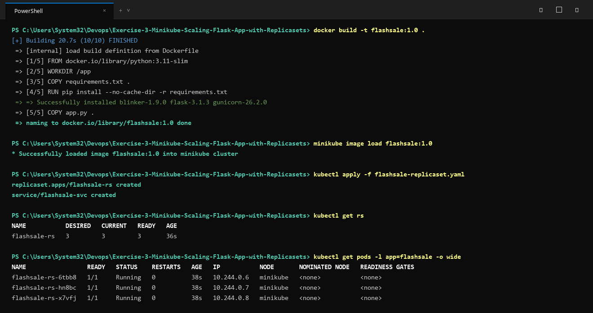

# Exercise 3: Scaling Flask App on Single Node using ReplicaSets

## Real-Life Use Case: E-Commerce Flash Sale
During a flash sale (e.g. Flipkart Big Billion Days), web traffic spikes exponentially. By defining a Kubernetes `ReplicaSet`, our application automatically maintains multiple replica Pods across the cluster, distributing incoming requests and automatically recovering if any Pod fails.

## Architecture
- **Flask App**: Simulates order placement on `/buy` route, showing the hostname of the servicing Pod to demonstrate load distribution. Includes `/health` for Kubernetes liveness and readiness probes.
- **ReplicaSet (`flashsale-rs`)**: Maintains 3 desired replicas, scalable to 5 or more on demand.
- **Service (`flashsale-svc`)**: Exposes port 80 routing to port 5000 of the replicas.

## Manifests & Files
- `app.py`: Flask application.
- `Dockerfile`: Container image definition.
- `flashsale-replicaset.yaml`: Kubernetes ReplicaSet and Service manifest.

## Execution & Verification

### 1. Build and Load Image into Minikube
```bash
docker build -t flashsale:1.0 .
minikube image load flashsale:1.0
```

### 2. Apply ReplicaSet and Service
```bash
kubectl apply -f flashsale-replicaset.yaml
```

### 3. Verify Pods and Replicas
```bash
kubectl get rs
kubectl get pods -l app=flashsale
```

### 4. Scale Out to 5 Replicas
```bash
kubectl scale rs flashsale-rs --replicas=5
kubectl get rs
kubectl get pods -l app=flashsale
```

### 5. Test Self-Healing (Resiliency)
Delete one pod and observe Kubernetes immediately launching a replacement to maintain the desired count:
```bash
kubectl delete pod $(kubectl get pods -l app=flashsale -o jsonpath="{.items[0].metadata.name}")
kubectl get pods -l app=flashsale
```

## Execution Proof & Screenshots

### 1. Build, Deploy & Verify 3 Replicas


### 2. Scale to 5 Replicas, Self-Healing & Endpoint Load Distribution


