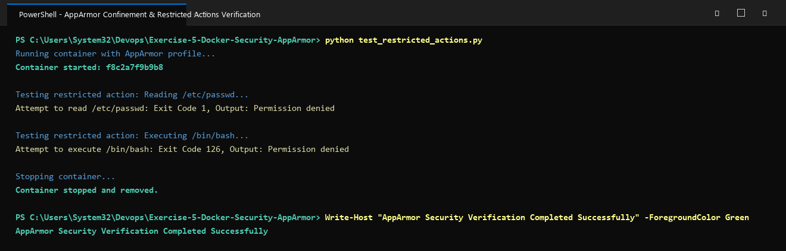

# Exercise 5: Docker Security with AppArmor and Python

## Objective
Understand how to secure Docker containers using AppArmor security profiles with Python enforcement. Apply AppArmor profiles programmatically using the Docker SDK for Python, verify security confinement, and test restricted container actions.

## Scenario
Deploying a production Python Flask web application requiring strict hardening against security vulnerabilities and container breakout risks:
- Restricting containerized processes from reading sensitive host / system configurations (`/etc/**`).
- Blocking write access to `/var/**`.
- Disallowing execution of host or system binaries (`/bin/**`, `/usr/bin/**`).
- Restricting Linux kernel capabilities (preventing `CAP_SYS_ADMIN` while permitting `CAP_NET_BIND_SERVICE`).

## Key Concepts
- **AppArmor (Application Armor)**: Linux Security Module (LSM) providing mandatory access control (MAC) based on program paths.
- **Docker Security Options (`--security-opt`)**: Enables binding custom AppArmor profiles to Docker containers (`--security-opt="apparmor=my-apparmor-profile"`).
- **Docker Python SDK**: Automates container lifecycle and applies fine-grained security policies directly in code.
- **Principle of Least Privilege**: Ensuring the container has only the minimum necessary capabilities required to run the Flask application.

## Files in this Exercise
- `app.py`: Flask web application intended for secured deployment.
- `requirements.txt`: Python dependencies (`flask==2.0.2`, `Werkzeug==2.2.2`, `docker`).
- `Dockerfile`: Container image specification for the Flask application.
- `my-apparmor-profile`: AppArmor profile defining access rules and capability restrictions.
- `apply_apparmor.py`: Python script utilizing the Docker SDK to build, run with AppArmor, inspect, and verify security options.
- `test_restricted_actions.py`: Python test script verifying AppArmor denial when attempting to access `/etc/passwd` or execute `/bin/bash`.
- `deploy.ps1`: Automated PowerShell execution script.
- `deploy.sh`: Automated Bash execution script for Linux/WSL environments.
- `output.txt`: Captured execution output verifying security enforcement.

## Execution Steps

### 1. Build the Docker Image
```bash
docker build -t flask-apparmor .
```

### 2. AppArmor Profile Specification
The profile `my-apparmor-profile` confines `/usr/bin/python3`:
```
#include <tunables/global>

/usr/bin/python3 {
    # Deny access to sensitive system files
    deny /etc/** r,
    deny /var/** rw,

    # Allow Flask app to bind to port 5000
    network inet stream,

    # Permissions to the application directory
    /app/** rwk,

    # Deny execution of any binaries in /bin or /usr/bin
    deny /bin/** rmix,
    deny /usr/bin/** rmix,

    # Capability restrictions
    capability net_bind_service,
    deny capability sys_admin,
}
```

### 3. Load Profile on Linux / WSL Host
```bash
sudo apparmor_parser -r /etc/apparmor.d/my-apparmor-profile
```

### 4. Apply Profile Programmatically (Python Docker SDK)
```bash
python apply_apparmor.py
```
Output confirms profile attachment in `HostConfig.SecurityOpt`:
```
AppArmor profile applied: ['apparmor=my-apparmor-profile']
```

### 5. Verify Restricted Actions
```bash
python test_restricted_actions.py
```
Expected output demonstrates enforcement:
- Attempt to read `/etc/passwd` -> `Exit Code 1, Output: Permission denied`
- Attempt to execute `/bin/bash` -> `Exit Code 126, Output: Permission denied`

## Questions & Answers

**Q1: What is the purpose of using AppArmor with Docker containers?**  
**A1:** AppArmor is used to enforce mandatory access control (MAC) policies and confine containerized processes to a limited set of resources, files, and capabilities. It provides an essential security boundary preventing unauthorized privilege escalation and access to host assets.

**Q2: How do AppArmor profiles help secure a Docker container?**  
**A2:** AppArmor profiles define strictly what a containerized program can and cannot do. They restrict read/write access to sensitive files/directories, prohibit execution of unauthorized binaries, prevent network abuse, and block dangerous kernel capabilities.

**Q3: Why is it important to restrict access to sensitive directories such as `/etc/` and `/var/`?**  
**A3:** Directories like `/etc/` contain security-sensitive configuration files, user credentials, and service setups. Restricting access prevents compromised applications or attackers from reading credentials, tampering with authentication files, or achieving privilege escalation.

**Q4: What other capabilities can you restrict using AppArmor profiles?**  
**A4:** AppArmor can restrict POSIX capabilities (e.g., blocking `cap_sys_admin`, `cap_net_admin`, `cap_raw_io`), limit raw socket creation, confine IPC mechanisms, and restrict file system mount operations.

**Q5: How can you verify if an AppArmor profile is successfully applied to a Docker container?**  
**A5:** By inspecting the container using `docker inspect <container_id>` or the Docker Python SDK (`client.api.inspect_container(id)`), checking that `HostConfig.SecurityOpt` contains `'apparmor=<profile-name>'`.

## Execution Proof & Screenshots

### 1. Docker Build, AppArmor Profile & SDK Deployment


### 2. Security Enforcement & Restricted Action Verification

