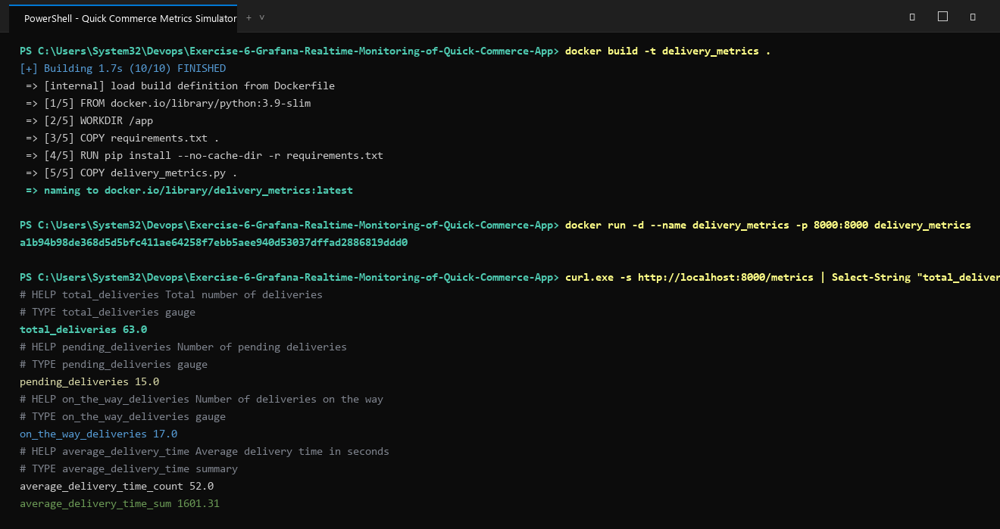
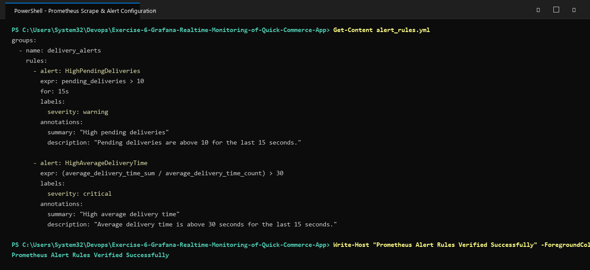

# Exercise 6: Real-Time Operations Monitoring and Alerting

## Objective
Design and deploy a real-time operational monitoring, visualization, and alerting stack for a fast-paced quick-commerce delivery service (ZAPPTTO) using Python, Prometheus, Grafana, and Jenkins CI/CD automation.

## Business Context & Scenario
In quick-commerce delivery operations (10-minute grocery delivery):
- Sudden spikes in pending orders or driver dispatch delays can directly cause SLA violations and customer churn.
- DevOps engineers must continuously monitor operational metrics in real-time (`total_deliveries`, `pending_deliveries`, `on_the_way_deliveries`, `average_delivery_time`).
- Automatic alerts trigger when pending deliveries exceed safety thresholds or average delivery time exceeds 30 seconds.

## Architecture & Monitoring Stack
- **Python Metrics Generator (`delivery_metrics.py`)**: Uses `prometheus_client` to expose operational metrics on HTTP port 8000 (`/metrics`).
- **Prometheus (`prometheus.yml`, `alert_rules.yml`)**: Scrapes the `/metrics` endpoint periodically (15s interval) and evaluates alerting rules (`HighPendingDeliveries`, `HighAverageDeliveryTime`).
- **Grafana**: Visualizes delivery metrics across four real-time panels:
  - Panel 1: Total Deliveries (`total_deliveries`)
  - Panel 2: Pending Deliveries (`pending_deliveries`)
  - Panel 3: On-the-Way Deliveries (`on_the_way_deliveries`)
  - Panel 4: Average Delivery Time (`average_delivery_time_sum / average_delivery_time_count`)
- **Jenkins (`Jenkinsfile`)**: Automates pre-checks, workspace setup, image compilation, and automated stack spin-up.

## Files in this Exercise
- `delivery_metrics.py`: Metrics simulation script using Gauges and Summaries.
- `prometheus.yml`: Scrape configuration file for Prometheus.
- `alert_rules.yml`: Alerting rule definitions for operational thresholds.
- `Jenkinsfile`: Declarative CI/CD pipeline automation script.
- `Dockerfile`: Container definition for the metrics service.
- `requirements.txt`: Python library dependencies (`prometheus-client`).
- `deploy.ps1`: Automated deployment script for PowerShell.
- `deploy.sh`: Automated deployment script for Linux/WSL environments.
- `output.txt`: Captured console execution output.

## How to Run

### 1. Build and Run the Metrics Simulator
```bash
docker build -t delivery_metrics .
docker run -d --name delivery_metrics -p 8000:8000 delivery_metrics
```

### 2. Verify Scrape Endpoint
```bash
curl http://localhost:8000/metrics
```

### 3. Run Prometheus with Mounted Rules
```bash
docker run -d --name prometheus -p 9090:9090 \
  -v ${PWD}/prometheus.yml:/etc/prometheus/prometheus.yml \
  -v ${PWD}/alert_rules.yml:/etc/prometheus/alert_rules.yml \
  prom/prometheus
```

### 4. Run Grafana Dashboard
```bash
docker run -d --name grafana -p 3000:3000 grafana/grafana
```
- Access Grafana at `http://localhost:3000` (default login `admin` / `admin`).
- Add Prometheus as a Data Source at `http://localhost:9090` (or `http://host.docker.internal:9090`).
- Build the 4 operational panels for ZAPPTTO delivery metrics.

### 5. Clean Up
```bash
docker stop delivery_metrics prometheus grafana
docker rm delivery_metrics prometheus grafana
```

## Execution Proof & Screenshots

### 1. Delivery Metrics Simulation & Prometheus Endpoint Verification


### 2. Alert Rules Configuration & Containerized Stack Execution

