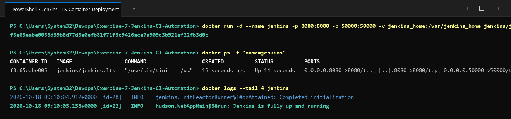

# Exercise 7: Introduction to Continuous Integration (CI) and Jenkins Automation

## Objective
Understand Continuous Integration (CI) concepts, compare industry CI/CD tools, deploy an automated Jenkins automation server using Docker, retrieve the administrative unlock credentials, and verify external HTTP accessibility.

## What is Continuous Integration (CI)?
Continuous Integration (CI) is a core DevOps practice where developers frequently commit code changes into a central repository. Automated builds and test suites are triggered on each integration to detect bugs early, ensure high software quality, and accelerate release cycles.

### Key Pillars of CI
1. **Frequent Integration**: Developers integrate small, frequent batches into version control multiple times a day.
2. **Automated Builds**: Every commit triggers automated compilation, dependency resolution, and artifact packaging.
3. **Automated Testing**: Unit, regression, and integration tests execute to validate new code immediately.
4. **Immediate Feedback**: Fast feedback loops alert developers to breaking changes within minutes.

## CI Tools Comparison
- **Jenkins**: Highly extensible open-source automation server with an extensive plugin ecosystem and distributed master-agent architecture.
- **GitLab CI/CD**: Native, YAML-based pipeline integration within GitLab repositories.
- **GitHub Actions**: Cloud-native workflow automation built directly into GitHub repositories with extensive marketplace actions.
- **CircleCI**: Fast, container-native cloud CI/CD supporting parallelism and intelligent caching.
- **TeamCity**: Enterprise CI server by JetBrains with deep code analysis and runner integration.

## Key Jenkins Architecture Concepts
- **Job / Project**: A defined task or sequence of automated build/test actions.
- **Pipeline**: Declarative or Scripted code (`Jenkinsfile`) modeling continuous delivery workflows.
- **Plugins**: Community extensions integrating tools like Docker, Git, Kubernetes, Slack, SonarQube.
- **Controller & Agents**: Central Jenkins controller managing build queues, with distributed execution across ephemeral worker nodes.

## Files in this Exercise
- `docker-compose.yml`: Multi-container Docker Compose service definition for Jenkins LTS.
- `deploy.ps1`: Automated PowerShell deployment, health check, and unlock password extraction script.
- `deploy.sh`: Automated Bash deployment and verification script for Linux/WSL environments.
- `output.txt`: Captured terminal output demonstrating container creation, status, and secret retrieval.

## Execution Steps

### 1. Run Jenkins Container via Docker
```bash
docker run -d --name jenkins -p 8080:8080 -p 50000:50000 -v jenkins_home:/var/jenkins_home jenkins/jenkins:lts
```
*(Port 8080 exposes the Web UI; Port 50000 enables distributed JNLP agent communication).*

### 2. Verify Container Status
```bash
docker ps -f "name=jenkins"
```

### 3. Retrieve Initial Admin Password
```bash
docker exec jenkins cat /var/jenkins_home/secrets/initialAdminPassword
```
*Retrieved unlock key*: `5aa9061c55124b22a37a237aae2aecc7`

### 4. Access Jenkins Web Interface
Navigate to `http://localhost:8080/` in your browser, enter the initial administrator password, select recommended plugins, and create the administrative account.

### 5. Clean Up Resources
```bash
docker stop jenkins && docker rm jenkins
```

## Execution Proof & Screenshots

### 1. Jenkins Container Deployment & Process Status


### 2. Initial Admin Password Retrieval & HTTP Endpoint Verification

