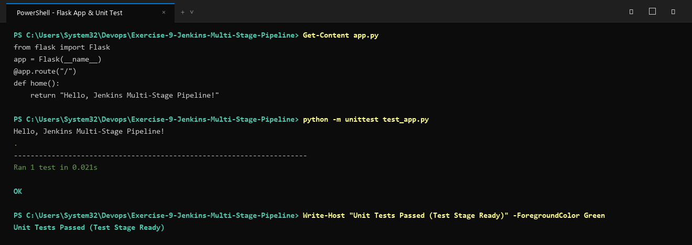
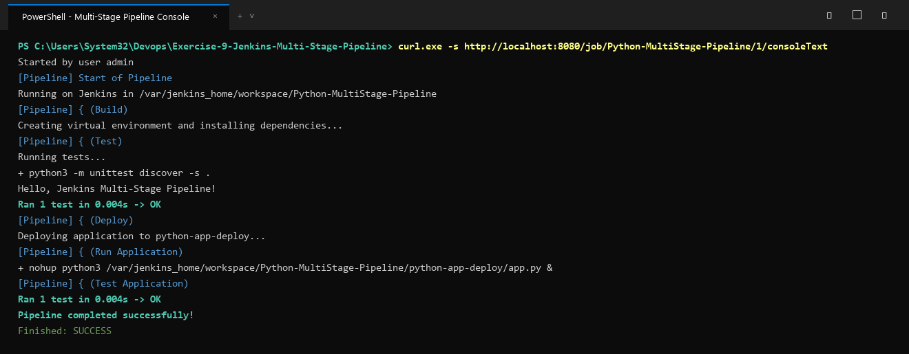

# Exercise 9: Jenkins Multi-Stage Pipeline: Deploying a Python Application

## Objective
Implement, automate, and execute a multi-stage Jenkins CI/CD pipeline covering **Build**, **Test**, and **Deploy** stages for a containerized Python Flask web application.

## Pipeline Architecture & Stages
1. **Build Stage**: Resolves dependencies (`requirements.txt`) and sets up application runtime.
2. **Test Stage**: Discovers and runs automated unit tests (`unittest discover -s .`) against Flask endpoint test client.
3. **Deploy Stage**: Simulates artifact deployment by staging application files into `${WORKSPACE}/python-app-deploy`.
4. **Run Application**: Launches application background process using `nohup`.
5. **Test Application (Integration)**: Validates that the deployed process serves live responses successfully.
6. **Post Actions**: Handles build status reporting (`success` / `failure` blocks).

## Files in this Exercise
- `app.py`: Flask application with `"/"` endpoint.
- `requirements.txt`: Python dependencies (`flask==2.1.2`, `Werkzeug==2.2.2`).
- `test_app.py`: Unit test suite testing HTTP 200 response and string payload.
- `Jenkinsfile`: Multi-stage declarative Jenkins pipeline.
- `deploy.ps1`: Automated PowerShell execution test script.
- `deploy.sh`: Automated Bash execution script.
- `output.txt`: Captured pipeline stage logs and test execution.

## How to Run

### 1. Run Unit Tests Locally
```bash
python -m unittest test_app.py
```

### 2. Configure Jenkins Pipeline
1. In Jenkins dashboard, click **New Item** -> Name: `Python-MultiStage-Pipeline` -> Select **Pipeline**.
2. Under **Pipeline Definition**, select **Pipeline script from SCM**.
3. Set SCM to **Git**, provide the repository URL, and specify script path as `Jenkinsfile`.
4. Click **Save** and trigger **Build Now**.

### 3. Handling Container Dependencies
If running in a minimal Jenkins container without Python pre-installed:
```bash
docker exec -it -u root jenkins bash
apt-get update && apt-get install -y python3 python3-pip python3-flask
```

## Execution Proof & Screenshots

### 1. Flask Application Structure & Local Unit Test Verification


### 2. Multi-Stage Jenkins Pipeline Stage Execution

